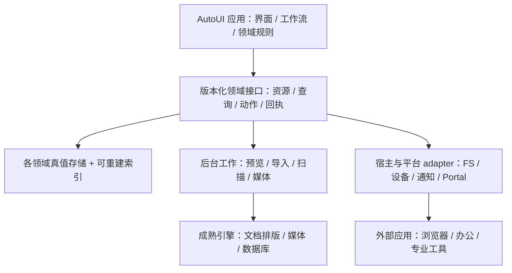

# 从调研到长期可维护的实现

日期：2026-10-22。本文为实现路线研究 D；接口名和模块拆分是候选，不是已实现 SDK 或对现有 PLAN-049 的扩围。

## 1. 分工与复用原则

应用 UI、store、领域逻辑与 API 契约遵循本仓 `.at`/AutoUI 规范；复杂排版、解码、系统设备、索引库等走成熟引擎与经审核的框架/宿主服务接缝。不得为了“复用 Rust 引擎”在 app 仓绕过纯 Auto 后端纪律；新增 native binding 应在所属语言/平台仓独立立项、复审，再给 app 稳定能力。

复用顺序：审现有实现与 Spec → 验证已有库/平台能力 → 做薄 adapter → 必要时补领域实现。单独维护新 broker、全新同步协议、排版系统或播放器内核通常成本更高，应以明确缺口和比较证据决定。

### 应用/平台边界图（候选）

这是一张职责图，不要求首版部署六个 daemon，也不要求所有 app 共享一个数据库。优先使用现有进程与简单模块；只有隔离、独立生命周期、权限或测量结果需要时才拆服务。

## 2. 共同能力与实际前提

| 能力 | 建议复用方式 | 应用受益 | 当前前提/限制 |
|---|---|---|---|
| 资源/来源引用 | 路径/URI 与身份/内容版本分开；大资产用引用；来源 locator 由领域定义 | Files/Reader/Notes/Photos/Blog | 现有 open_with 可用范围查 Spec；统一身份仍需设计，不自称已经贯通知识系统 |
| 持久化/迁移 | 每领域一个真值；事务写/原子替换、schema 迁移、备份恢复、导出 | 全部日用 app | 不把浏览器 localStorage 或内存列表当所有平台可靠数据库；先审各 app 现状 |
| 搜索 | 文件名路径、领域全文、元数据三类索引；有限结果与取消；索引可重建 | Launcher/Files/Notes/Reader | [SQLite FTS5](https://www.sqlite.org/fts5.html) 是全文候选，中文 token/子串与大库性能要探针；不预设一个搜索服务包办全部 |
| 预览/缩略图 | 异步 worker、版本键缓存、大小/时间预算、失败降级 | Files/Launcher/Photos/桌面资料盒 | 框架已有图像管线先核对；隔离模型因平台而异，不照抄 Bubblewrap 到 Windows |
| 文档内容与编辑 | 优先既有 AutoDown 引擎；领域层与编辑器状态分开；导入导出保持来源 | Notes/Jade/Blog | 本地 AutoDown 架构描述 parser/render/editor 三层，浏览器 DOM 编辑合同不能直接推导 VM 完整实现 |
| 阅读排版 | EPUB/HTML 引擎与 PDF 引擎分开，用领域 locator 抽象 | Reader/预览 | foliate-js 只证明浏览器模块存在；VM 原生嵌入和选区未验证 |
| 媒体 | 播放服务明确会话/队列/状态；解码交成熟内核，控制与视频表面分开 | Music/Video/Preview | 现有媒体基础先复核；JSON IPC 成功不等于嵌入渲染成功 |
| 后台工作 | ID、进度/阶段、取消、失败、部分完成、回执；按任务类型决定重启恢复 | 导入/扫描/传输/AI | 已有 F0/F1 短调用不是完整长任务/流/取消平台；F2 依赖不得跳过 |
| 提醒与通知 | 系统级调度/宿主通知、去重、睡眠恢复、时区语义 | Clock/Todo/Calendar | UI Tick 或窗口存在不是可靠提醒保证；后台生命周期需平台探针 |
| 调用/诊断 | 领域 API/能力/回执，与 UI 自动化分开；统一 trace/错误投影 | Launcher/Agent/DevTools | 沿通信 RFC、Design02 与后续实际版本；不能自造第二套注册与授权 |
| 宿主整合 | open URI/file、默认关联、Portal、媒体键、剪贴板、窗口 | 全部 | [XDG Portal](https://flatpak.github.io/xdg-desktop-portal/docs/) 是 Linux 生态接入规范，AutoOS 是否已有相应 backend 另验 |

## 3. 引擎/实现选项总表

以下仅是候选方向；来源与许可核查深度见 [sources](sources.md)。GPL/AGPL 等并非禁止使用，MIT/Apache 也非无需履行条件；实际采用应把固定版本、第三方组件、链接/进程/分发形式一起记录。本轮不作最终法律结论。

| 领域 | 方案 A / 方案 B | 选择条件 |
|---|---|---|
| 文件 | 现有 `.at` FS + 框架异步/系统 adapter / 集成外部文件管理器 | 数据正确性、取消/回收站、双端完整度；不为列视图先换内核 |
| 阅读 | foliate-js/PDF 引擎 + AutoUI / Readest 独立集成 | 原生合成、选区/标注/CJK 及许可；Readest fork 增量与上游分开 |
| 文档 | 既有 AutoDown/Jade 引擎 / 外部文档服务导入导出 | 现有块模型、格式兼容/恢复是否足够；先防重复开发 |
| 播放 | 现有媒体管线 / mpv 受控进程或 libmpv（VLC 为备选） | 音画同步/设备/合成/生命周期和真实构建许可 |
| 数据 | 现有 SQLite 接口 / 新平台数据库 provider | 参数化查询、事务/迁移、取消、大数及只读保证 |
| 图表 | AutoUI 原生公共子集 / ECharts 或 Vega adapter | 规格语义能否双端覆盖、离线导出与数据类型 |
| 终端 | 现有引擎增强 / libghostty 等固定版本适配 | IME/PTY/滚屏/渲染、平台支持、维护负担；没有明确收益不换 |
| 计算 | 小范围受控表达式内核 / libqalculate 或 CLI | 精度/单位目标与依赖/许可成本是否匹配 |
| 日历 | 经验证时区/recurrence 接缝 / 现成 CalDAV 服务适配 | 本地 ICS 正确性先过，再谈账号/冲突/邀请 |
| 人际通信 | Matrix 客户端/SDK 集成 / 外部 Element | Chat 身份先定；不自研加密与联邦协议 |
| 浏览器/办公 | Firefox/LibreOffice 外部集成 / 未来深度 adapter | 原生窗口/输入/生命周期与默认关联可用，优先于重写内核 |

## 4. 先做哪些有明确结论的探针

每项后续由对应 Plan 的执行者负责；这里的“归属”是代码/产品责任，不是已经派工或授权创建新 agent。耗时、人力和承诺要在基线与首轮测量后估计。

| ID | 归属/输入 | 要跑通的整条路径 | 必须输出的决策 |
|---|---|---|---|
| P01 | OS + 各 app；manifest/gitlink/README/Spec | 28 条登记→实际检出/pin→启动/存储/测试入口 | 基线能力矩阵、缺检出/过时说明；不得把未审 app 判为无功能 |
| P02 | Reader + 框架；自建 EPUB/PDF | Vue/VM 打开→中文排版→选区→标注→保存→回跳 | 引擎与表面路线可行性；失败时选外部集成或明确范围 |
| P03 | Music/Video + 宿主；自建媒体 | 控制→解码→合成/音频输出→seek/设备变化→退出 | 现有引擎/mpv/libmpv 比较，真实格式/硬解支持表 |
| P04 | Explorer + 框架；合成目录 | 大目录枚举→选择→复制冲突→取消/失败→校验 | 保留现有基座的增量缺口，是否需要新 FS/worker 能力 |
| P05 | Notes/Jade/Blog；现存 schema 和 fixture | 捕获→落盘/回执→重启查询→导出/import | 真值归属、文档/附件合同，是否能共享引擎/引用 |
| P06 | Launcher + provider；真实查询样例 | 连续查询→慢结果→取消→选择有效动作 | provider 契约、排序评估方法、首个有用结果时延 |
| P07 | Clock/Todo/Calendar + 平台 | 设提醒→关窗口→睡眠/重启→触发/补偿 | 支持的后台语义和降级；不能由 UI 计时推导可靠提醒 |
| P08 | OS 通信/DevTools；现有 F01 结果 | 两 app 领域调用→持久回执→诊断关联 | 哪些能力已交付，哪些依赖 F2；不顺带改 PLAN-049 |
| P09 | OS + 宿主；Firefox/LibreOffice 测试文件 | 启动→聚焦/输入/剪贴板→open_with→关闭 | Windows/虚拟桌面/Linux 会话各自集成级别 |
| P10 | 产品/工程；固定来源与构建项 | 设计参考→代码/资产/依赖使用清单→产物 | 每个依赖的许可/维护/替代路线，不用仓库聚合字段代替审核 |

每项保存候选版本、fixture hash、平台/字体/DPI/后端、执行步骤、结果与失败截图/日志。提出性能预算时记录硬件/数据量与 p50/p95；本轮没有测量，不虚构“100ms/百万项”等产品承诺。探针失败是路线选择信息，不意味着偷偷降低原验收标准。

## 5. 产品化的共同发布门

1. **任务门**：实际用户能完成该 app 宣称的闭环；有可重复场景，不以截图/窗口数量代替。
2. **数据门**：保存→退出→重启→回读；导出/import；损坏/迁移/磁盘满/部分失败可恢复且不静默丢失。备份与同步分开验。
3. **平台门**：Vue、VM/原生各有功能与限制表，使用仓库要求的 autoui-verifier 后续验证；独立启动和桌面接入都跑，第三方集成单列。
4. **交互门**：键盘、中文输入/字体、焦点、主题、缩放/滚动、可访问名称与空/加载/错误状态；核心路径不依赖鼠标悬停才能发现。
5. **资源门**：真实数据规模、长时稳定、取消/背压/退出清理，搜索/解码不冻结主 UI。明确上限、部分结果和不支持原因。
6. **分发门**：干净环境安装/启动、资源路径、后端健康、依赖/许可证/版本、用户数据升级与回退策略；外部账号/密钥不写进默认数据。

先为本次实际改动补对应的意义验证，不为文档研究跑应用全回归；不改 auto-lang `crates/` 时遵守 Category A，禁止跑该仓 `cargo t`/`docs_gen`。

## 6. 从研究文档转为 Plan

每个实施 Plan 只承诺一个有边界的交付：例如“Reader 的 EPUB 导入/阅读/标注/导出”，而不是“把 Readest 全部重写”。引用本库来源和决策，列出当前 pin/已有能力、设计取舍、平台缺口 owner、数据迁移、真实任务验收与不支持项。先完成阻塞可行性，再开始依赖它的应用工作。

应用在 `auto-os/apps/<目录>` 按仓库日常检出规约实施；语言/OS 核心遵循各自 worktree 流程。研究建议不自动修改 app 仓，不更新 gitlink；实际提交与推送、父仓 pin 更新、切回 detached 按既有规范执行。Review 独立验证后才将已实现知识沉淀到 Spec；调研资料保留为来源与决策历史。
